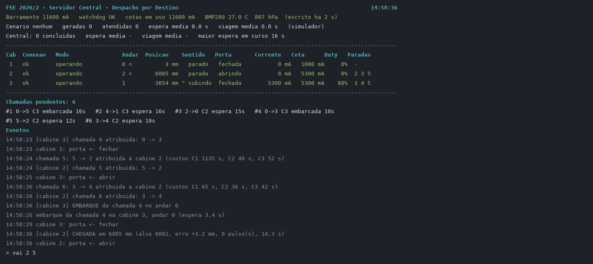
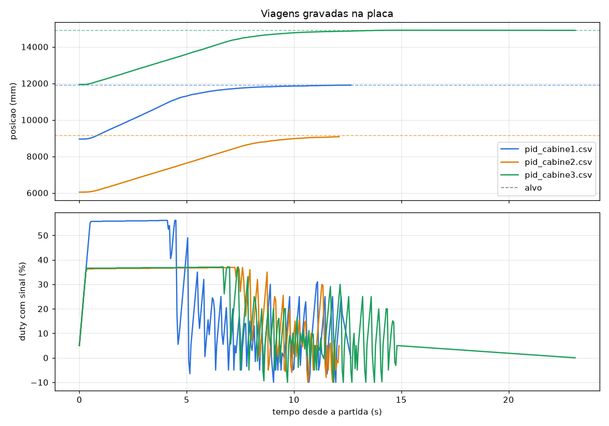
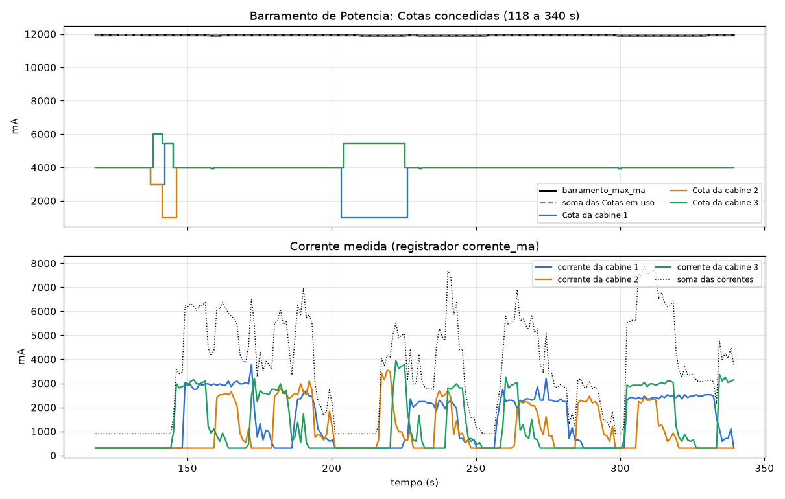
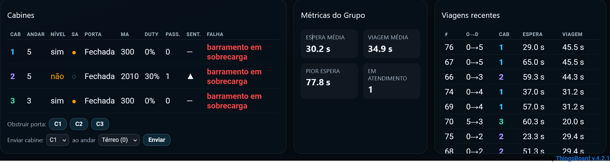
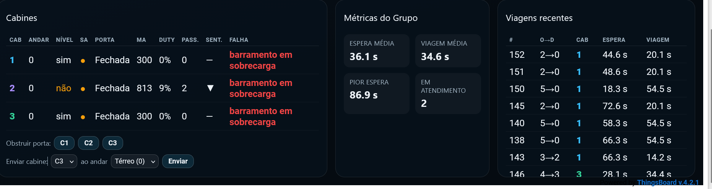
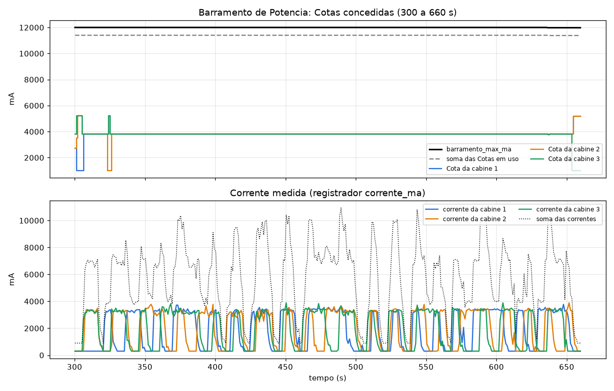
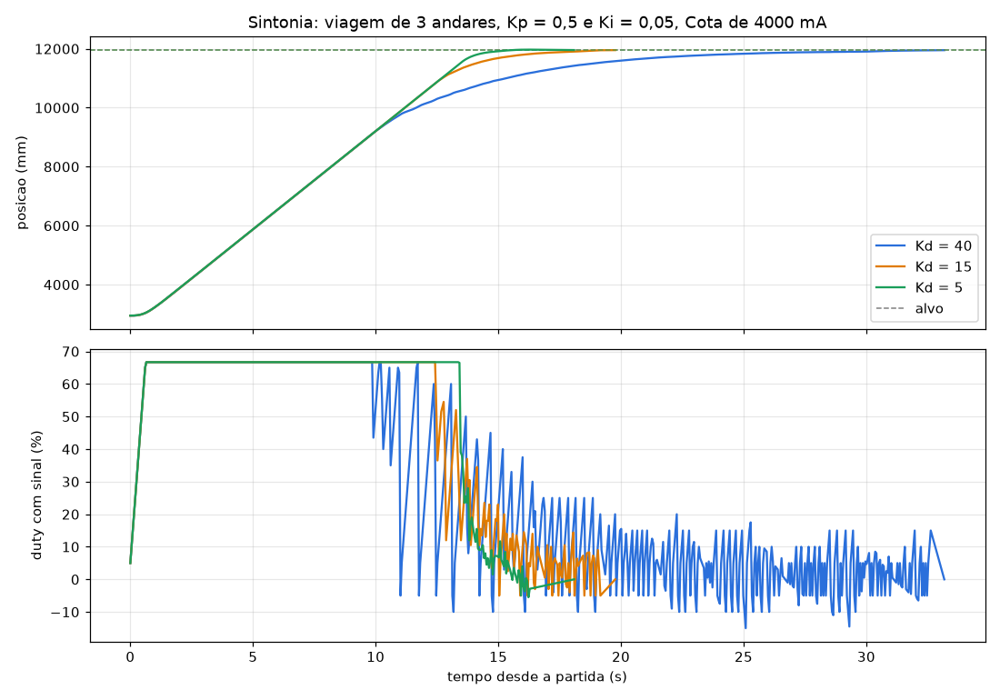
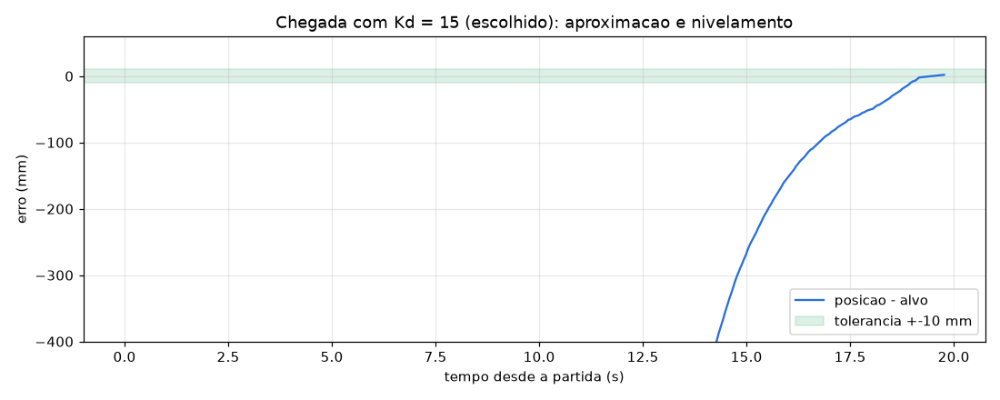
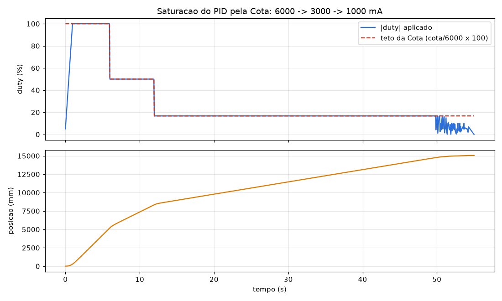
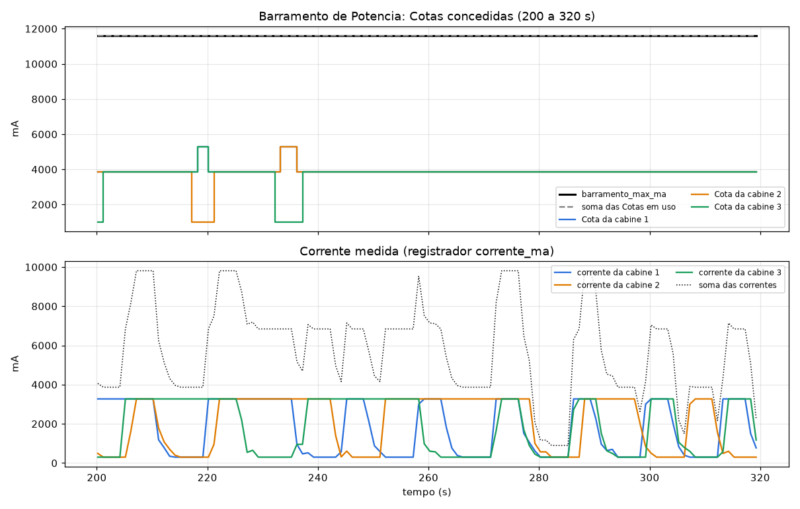

# Elevador Embarcado: Trabalho 1

Fundamentos de Sistemas Embarcados, 2026/2. Controle de um grupo de três
elevadores com Despacho por Destino em uma Raspberry Pi, contra o simulador de
edifício da ESP32 da bancada.

| Entrega | Conteúdo | Tag | Comando |
|:--|:--|:-:|:--|
| 1 | GPIO e malha de posição da Cabine 1 | `v1.0` | `python3 -m src.main` |
| 2 | UART-MODBUS (Partes 1, 2 e 3) e I2C | `v2.0` | `python3 -m src.comunicacao --matricula <matricula>` |
| Final | Servidor Central e três Servidores Distribuídos | `v3.0` | `./elevador placa` |

## Integrantes

Listados no repositório de entrega.

## Vídeos

| Entrega | Link |
|:--|:--|
| 1 | https://youtu.be/LKAWTPL8WLw |
| 2 | https://youtu.be/ICxFs3GONZo |
| Final | _(link do vídeo a adicionar)_ |

## Entrega Final

### Instalação

Python 3, sem dependências além da biblioteca padrão e da `RPi.GPIO`, que já
vem no Python da Raspberry Pi do laboratório. Em outra máquina (modo simulado,
testes e gráficos): `pip install -r requirements.txt`.

```bash
git clone https://github.com/Gxaite/embarcados-2026-2.git && cd embarcados-2026-2
echo <matricula> > matricula      # matrícula dos quadros MODBUS (ignorado pelo git)
```

### Configuração

Cada processo lê um arquivo em `config/`:

| Arquivo | Conteúdo |
|:--|:--|
| `cabine1.json`, `cabine2.json`, `cabine3.json` | pinos BCM (Tabela 1), endereço MODBUS, porta TCP, ganhos do PID, duty da calibração, tempo de porta aberta |
| `central.json` | UART, barramento I2C, endereço e porta TCP de cada cabine, arquivos de estado e de log |

As portas TCP padrão são 10101, 10102 e 10103, em `127.0.0.1`: os quatro
processos rodam na mesma placa. Para distribuir em máquinas diferentes basta
trocar o `host` de cada cabine no `central.json`.

### Execução

Todos os comandos passam pelo script `./elevador` (sem argumento, ele lista os
comandos):

| Comando | Função |
|:--|:--|
| `./elevador placa` | central e três cabines, uma janela do `tmux` cada, gravando `dados/pid_cabineN.csv` e `dados/potencia.csv` |
| `./elevador para` | Ctrl+C em cada processo (estado salvo, motores em freio) e fecha a sessão |
| `./elevador teste` | teste de aceitação na placa (seção [Testes](#testes)) |
| `./elevador simulado` | sistema completo sem placa (abaixo) |
| `./elevador graficos <pasta>` | gráficos dos CSVs copiados da placa ([Experimentos](#experimentos)) |

Antes de subir, confira no dashboard que nenhuma cabine está com falha
(registrador `falha` diferente de zero, borda vermelha na cabine): com falha
ativa a ESP32 ignora o motor e a calibração trava. O reset do dashboard limpa.

Na sessão do `./elevador placa`, `Ctrl+b` e o número troca de janela: 0 é o
painel do central, 1 a 3 são as cabines. Ctrl+C numa janela derruba só aquele
processo; `Ctrl+b c` abre uma janela nova para subi-lo de novo.

Os quatro processos sobem **em qualquer ordem**. À mão, um terminal para cada:

```bash
python3 -m src.central                 # painel em tela cheia; --sem-tela para texto
python3 -m src.distribuido --cabine 1  # uma de cada vez: subindo juntas no mesmo
python3 -m src.distribuido --cabine 2  # diretório, a lgpio disputa o pipe .lgd-nfy0
python3 -m src.distribuido --cabine 3  # e a cabine que perde morre no import
```

Ao conectar, cada cabine calibra sozinha (varredura de subida e de descida) e
vai nivelar no andar mais próximo; a partir daí atende as chamadas feitas no
quiosque do dashboard ou os Cenários de Tráfego.

Comandos do painel do Servidor Central:

| Comando | Função |
|:--|:--|
| `vai <cabine> <andar>` | envia a cabine ao andar (comando manual) |
| `corta-cota <cabine> [s]` | suspende a Cota da cabine por `s` segundos (padrão 15): ensaio do Modo Degradado |
| `status` | painel em texto |
| `sair` | encerra (o mesmo que Ctrl+C) |



Ctrl+C em qualquer processo encerra com segurança: a cabine zera o PWM, põe a
direção em freio e libera GPIO e TCP; o central salva o estado e fecha UART,
I2C e TCP. Subindo de novo, os outros reconectam sozinhos e o central reenvia
às cabines as chamadas pendentes salvas em disco.

### Sem a placa: modo simulado

```bash
./elevador simulado                    # o mesmo que python3 -m src.simulacao
```

Sobe num processo só o prédio simulado (`src/simulacao/`), as três cabines e o
central, com o mesmo código da placa e TCP de verdade em localhost. Comandos a
mais no painel: `chamada <origem> <destino>`, `cenario up-peak|down-peak|interfloor`,
`obstrui <cabine> [s]`, `derruba <cabine> [s]` (queda de TCP), `calor <°C>` e
`violacoes`.

## Arquitetura

```
                       Raspberry Pi
 +--------------------------------------------------------------+
 |  Servidor Central (src/central)       UART /dev/serial0 ------+--> ESP32: cabines 0x11-0x13
 |   contorno | predio | cabines | fila | cotas  I2C 0x76 (BMP280) |    e prédio 0x20
 |       |  TCP 10101   |  TCP 10102   |  TCP 10103              |
 |  Cabine 1         Cabine 2         Cabine 3  (src/distribuido)|
 |  GPIO 13,22,23..  GPIO 11,17,27..  GPIO 18,24,25..  ----------+--> motor, encoder, cortina,
 +--------------------------------------------------------------+    sensor de andar
```

- **Servidor Central** é o único dono da UART e do I2C. Cada cabine pede a ele
  o que é MODBUS da cabine (comando de porta, leitura de `andar_atual` e
  `porta_estado`), e ele encaminha a cada uma os registradores dela a cada 500 ms.
- **Servidores Distribuídos** são os únicos donos das GPIOs da sua cabine:
  PWM, direção, encoder, cortina e Sensor de Andar.
- **TCP**: cada cabine escuta na sua porta e o central conecta nas três,
  tentando de novo a cada segundo. Mensagens são um objeto JSON por linha
  (`src/rede/protocolo.py`):

| Sentido | Mensagem | Quando |
|:--|:--|:--|
| central → cabine | `cota` (mA, validade 2 s, número de sequência) | a cada 1 s |
| central → cabine | `chamada` (id, origem, destino) | atribuição do Despacho; reenviada após reconexão |
| central → cabine | `vai_andar`, `registradores`, `resposta` | comando manual, leitura MODBUS, resposta a pedido |
| cabine → central | `estado` (posição, andar, sentido, porta, corrente, Cota, paradas, eventos de embarque/desembarque) | a cada 500 ms |
| cabine → central | `pedido` (`le_cabine`, `porta abrir/fechar`) | ciclo de porta e calibração |

Uma conexão sem mensagem por 5 s é dada como morta, e cai para os dois lados.
Os eventos de embarque e desembarque vão repetidos nos relatórios de estado e o
central descarta os que já conhece, de modo que uma queda no meio não perde
evento.

## Implementação

**Controle PID de posição** (`src/distribuido/pid.py`, `malha.py`)

- Malha de 50 ms sobre a contagem do encoder (quadratura 4x por interrupção
  nos dois canais, 1 contagem = 1 mm, inteiro de 32 bits). O `posicao_mm` do
  MODBUS não é usado em lugar nenhum da malha.
- PID discreto por amostra, `u = Kp·e + Ki·Σe + Kd·Δ`, com a derivada sobre a
  medida (troca de destino no meio da viagem não dá chute), anti-windup por
  integração condicional e separação do integral (só acumula a menos de 50 mm
  do destino). A saída vira duty de 0 a 100% e direção (`DIR1`/`DIR2`).
- Rampa de aceleração de 100 %/s na subida do duty; reduzir é imediato.
- Cruzeiro limitado a 55% de duty: acima disso o Python perde bordas do
  encoder (19 mm em 3000 mm a 60% na rasp34), e a contagem que escorrega leva
  a porta fora do nível.
- Chegada: a menos de 6 mm do alvo e abaixo de 60 mm/s a cabine freia e
  assenta. Atrito estático: parada, com a saída abaixo de 12% e erro acima de
  30 mm, a saída vai ao arranque; abaixo de 30 mm o integral é congelado (sem
  windup) e o erro residual é corrigido por pulsos de arranque, cada um seguido
  de freio e nova medição. A cabine só é dada como chegada parada e a menos de
  6 mm, e a porta só abre dentro de ±10 mm.
- Fim de curso: 300 mm além dos andares extremos calibrados o movimento é
  cortado; travamento (duty sem deslocamento por 2,5 s) também.

**Calibração e Sensor de Andar** (`bandeirola.py`, `calibracao.py`, `mapa.py`)

- O Sensor de Andar é lido por interrupção nas duas bordas, com a contagem e o
  sentido do encoder capturados na borda crua, antes do debounce.
- Na partida a cabine desce até sair da bandeirola do andar 0, sobe
  atravessando as seis (varredura de subida) e desce de novo (varredura de
  descida). A qual andar pertence cada bandeirola é perguntado ao central
  (`andar_atual`, registrador 0) na entrada dela. O registrador `nivelado`
  nunca é consultado.
- Cada borda é a média das duas varreduras; o andar é a média das duas
  bordas. O mapa vai para `dados/calibracao_cabineN.json`.
- **Reancoragem**: cada borda cruzada na operação é classificada (inferior ou
  superior, pelo sentido) e a contagem é corrigida para o valor calibrado
  daquela borda. Correção acima de 80 mm numa borda isolada é recusada como
  ruído; duas bordas seguidas que pedem a mesma correção (a 25 mm) confirmam um
  deslize da contagem, que é aplicado.

**Cota de Potência e Modo Degradado** (`cota.py`, `src/central/cotas.py`)

- A cabine satura o PID em `duty_max = cota / 6000 × 100`, aplicado no
  instante em que a Cota chega e um ciclo antes de ela vencer. Abaixo disso,
  pelo modelo de corrente que ela mede na ESP32 (repouso de ~300 mA mais
  ~54 mA por ponto de duty), o teto é o maior duty cuja corrente prevista cabe
  na Cota com 10% de folga, para o pico da partida.
- O central reparte 95% de `barramento_max_ma` (o resto é reserva para os
  picos de partida): 1000 mA para cada cabine, o resto
  para as que têm viagem, até 6000 mA cada. Uma Cota enviada conta como em uso
  até a cabine confirmar uma posterior (número de sequência no relatório) ou
  vencer: assim uma redução sempre chega antes do aumento que ela libera, e a
  soma nunca passa do barramento nem no transitório. Cabine sem Cota (caída ou
  suspensa) fica com 1000 mA reservados, que é o que ela usa em degradado.
- Sem Cota válida a cabine entra em Modo Degradado: teto de 1000 mA, pouso no
  próximo andar no sentido do movimento, nivelamento, porta aberta até voltar
  a Cota.

**Despacho por Destino** (`src/central/despacho.py`, `src/distribuido/itinerario.py`)

- Cada chamada vai para a cabine de menor custo estimado: tempo até a porta
  abrir na origem, mais o atraso imposto aos passageiros já atribuídos (no
  embarque de quem espera e no desembarque de todos) e uma fração da viagem do
  passageiro novo. O custo sai de uma simulação do
  itinerário da cabine com a mesma regra que ela executa (`escolhe_parada`):
  SCAN que só para no caminho para quem vai no sentido da varredura; quem vai
  ao contrário embarca na volta, e a origem contrária mais distante é o ponto
  de inversão. Origem que já é parada da cabine não custa parada nova: é o
  agrupamento de passageiros.
- Lotação: a ESP32 acusa sobrecarga com 8 a bordo. O despacho conta os
  passageiros a bordo instante a instante no itinerário simulado; a cabine que
  passaria de 7 não recebe a chamada, e sem nenhuma com lugar ela espera na
  fila da ESP32.
- Limite de 90 s: a viagem é estimada na velocidade da fatia de um terço do
  barramento (a Cota que a cabine tem com as três ocupadas), e a chamada que
  levaria alguém além de 65 s de espera é penalizada. Na cabine, uma origem
  esperando há mais de 50 s passa na frente da varredura. No up-peak
  (`cenario_ativo` = 1) a cabine ociosa volta ao térreo.
- Só entram cabines calibradas e operando. Sem nenhuma, a chamada fica na fila
  do simulador: toda chamada retirada é atribuída e atendida.
- "Resetar simulação" recomeça os ids da ESP32 em 1. Um id menor que o último
  atribuído abre uma época nova: a chave de cada chamada é época × 100000 + id,
  as pendentes antigas são descartadas e as cabines as esquecem.
- Fluxo da Seção 5.3: lê a fila, atribui (offsets 9 e 10 numa escrita só),
  retira (`chamada_pop`, sem repetir às cegas) e avisa a cabine.
- Log persistente em `dados/viagens.csv` (id, origem, destino, cabine,
  registro, embarque, desembarque, espera, viagem) e estado em
  `dados/central_estado.json`, regravado de forma atômica a cada mudança.

**Porta e cortina** (`src/distribuido/porta.py`)

- Abrir, esperar `tempo_aberta_s` (1 s: embarque e desembarque contam quando
  ela abre), fechar; a cabine só anda com a porta
  confirmada fechada pelo MODBUS. Cortina por interrupção com debounce de
  20 ms: obstruída, o fechar não é enviado; obstrução durante o fechamento
  inibe o ciclo, que é reiniciado 0,5 s depois de a obstrução cessar.

**Qualidade**: nenhum laço sem espera (todas as threads dormem em
`Event.wait`, `select` ou no `recv` do socket); SIGINT, SIGTERM e SIGHUP
tratados nos quatro processos.

## Experimentos

### Na placa (rasp52, 28/10/2026)

`./elevador teste` na rasp52, que tem o BMP280 em `0x76`:

| Item | Resultado |
|:--|:--|
| Comunicação TCP | cabines subiram antes do central; as três conectadas em 1 s |
| Condição de Contorno | BMP280 a 24,5 °C, `watchdog_ambiente` = 0, `barramento_max_ma` = 12000 (a fórmula dá 12000) |
| Calibração | 98 s para as três juntas; vãos de 2865 a 3090 mm, bandeirolas de 121 a 281 mm |
| PID | 6 de 6 viagens niveladas pelo registrador `nivelado`, erro de chegada de −7,5 a +8,0 mm |
| Malha de 50 ms | 4393 ciclos, atraso médio 0,09 ms e máximo 2,6 ms, nenhum perdido, sem SCHED_FIFO (usuário comum) |

Posições de andar medidas, em mm:

| Cabine | Andar 0 | 1 | 2 | 3 | 4 | 5 | Larguras das bandeirolas (0 a 5) |
|:-:|:-:|:-:|:-:|:-:|:-:|:-:|:--|
| 1 | 1 | 3001 | 6000 | 8946 | 11906 | 14862 | 192, 241, 141, 271, 171, 221 |
| 2 | 60 | 3115 | 6040 | 9130 | 12055 | 15110 | 261, 151, 211, 121, 281, 181 |
| 3 | 25 | 2890 | 5960 | 8876 | 11940 | 14896 | 162, 231, 252, 201, 131, 271 |

Viagens, cada cabine ao andar 5 e depois ao 4:

| Cabine | Ao andar 5 | Ao andar 4 |
|:-:|:-:|:-:|
| 1 | 31,8 s, +2,5 mm | 20,3 s, −7,5 mm |
| 2 | 39,5 s, +8,0 mm | 12,8 s, 0,0 mm |
| 3 | 28,3 s, −1,5 mm | 11,5 s, +0,5 mm |

Última viagem de cada cabine (`./elevador graficos`): rampa até o teto da
Cota, cruzeiro, e a aproximação em que o duty oscila de −10 a +30% até a
cabine assentar no alvo.



Barramento de 11940 mA repartido em três Cotas de cerca de 3980 mA, que caem
para 1000 mA na cabine ociosa e sobem para 5460 ou 6000 mA nas que viajam. A
soma das Cotas fica no barramento e a corrente de cada cabine abaixo da sua
Cota; parada, a ESP32 marca 300 mA.



O que a placa mostrou e o simulador não:

- a corrente não é proporcional ao duty: são 300 mA com a cabine parada mais
  cerca de 54 mA por ponto de duty (1212 mA a 17%, 2300 mA a 37%, 3000 mA a
  56%). O simulador passou a usar esse modelo;
- no gráfico acima as cabines 2 e 3 cruzam a 37% com Cota de 3980 mA, quando
  a corrente medida permitia mais: um fator único sobre a fórmula, medido em
  duty baixo onde os 300 mA pesam (e numa leitura até 0,5 s atrasada), travava
  o cruzeiro e deixava 40% do barramento ocioso. O teto agora sai do modelo de
  corrente medido, limitado aos 55% em que o encoder acompanha;
- a ESP32 acusa sobrecarga (bit `0x0010` de `falha`) com 8 passageiros a bordo
  e espera acima de 90 s (`0x0020`); o despacho passou a respeitar a lotação de
  7 e a não pegar no caminho quem vai ao contrário (viagens 2 → 0 de 168 s no
  down-peak);
- a ESP32 gera cerca de 75 chamadas num cenário de 5 minutos, contra ~50 no
  simulador: os picos ficam no limite do que três cabines com 7 lugares
  transportam, e cada segundo de parada conta (freio de chegada a 6 mm, Kd 8,
  porta aberta 1 s);
- "Resetar simulação" com o programa rodando recomeça os ids das chamadas e
  muda a posição das cabines por baixo da calibração. O central detecta os ids
  recomeçando; a calibração só volta a valer subindo as cabines de novo;

- na primeira rodada a ESP32 ligou a falha `0x0004` nas três cabines uns 90 mm
  abaixo do térreo, no começo da calibração, e passou a ignorar o motor
  (corrente sem movimento). Depois do reset do dashboard a mesma descida
  funcionou; a causa não foi confirmada. A cabine agora registra no log cada
  mudança do registrador `falha`;
- sem o programa, com os pinos liberados, as cabines escorregam até o fundo do
  poço;
- a `lgpio` (por baixo da `RPi.GPIO`) cria o pipe `.lgd-nfy0` no diretório
  corrente, e três cabines subindo juntas no mesmo diretório disputam o
  arquivo. O `./elevador placa` e o teste dão um diretório a cada uma.

Para gerar os gráficos a partir de uma rodada na placa (a placa não tem
matplotlib): copiar a pasta para o PC e rodar `./elevador graficos`, que grava
`docs/imagens/pid_placa.png` (última viagem de cada cabine: posição, alvo e
duty) e `docs/imagens/potencia_placa.png` (barramento, Cotas e correntes):

```bash
scp -r -P <porta> <usuario>@<placa>:embarcados-2026-2/dados/teste_<data>_<hora> .
./elevador graficos teste_<data>_<hora>
```

### Cenários de Tráfego na placa (rasp52, 29/10/2026)

Os cenários disparados no widget, com `./elevador placa`. Espera e viagem
saem de `dados/viagens.csv` (registro do central) e batem com as Métricas do
Grupo do widget, a menos de décimos.

| Versão | Cenário | Chamadas | Espera média | Espera máxima | Acima de 90 s | Viagem média |
|:--|:--|:-:|:-:|:-:|:-:|:-:|
| 28/10 (`685dfcd`) | Interfloor | 75 | 31,2 s | 99,7 s | 1 | 51,4 s |
| 28/10 (`685dfcd`) | Up-peak | 75 | 49,5 s | 100,3 s | 8 | 44,9 s |
| 28/10 (`685dfcd`) | Down-peak | 75 | 36,5 s | 91,1 s | 1 | 41,8 s |
| entregue | Up-peak | 76 | 30,3 s | 77,7 s | 0 | 35,4 s |
| entregue | Down-peak | 75 | 36,2 s | 86,7 s | 0 | 34,8 s |





Na primeira rodada as viagens levavam 15 s entre duas aberturas de porta em
andares vizinhos (5,4 s de ciclo da porta da ESP32) e mais 6,7 s por andar a
mais. No up-peak cada cabine saía do térreo com 7 passageiros e parava em todos
os andares, e a volta passava de 120 s. Duas mudanças baixaram a espera:

- o teto de duty: a cabine guardava o pior consumo visto (até 87 mA por ponto
  de duty na cabine 1, num pico de ruído) e cruzava a 36%. Medido em 2207
  leituras com o duty parado, o consumo é de 56 mA por ponto, igual subindo e
  descendo e de 40 a 60% de duty. Com o percentil 90 das últimas 40 medidas, as
  três cruzam a 50-55%;
- o despacho passou a contar o atraso que um passageiro novo impõe também ao
  desembarque de quem ainda vai embarcar. Antes, um destino novo não custava
  nada a quem esperava no térreo, e o up-peak não agrupava quem vai ao mesmo
  andar.

Barramento durante o up-peak: soma das Cotas em 11400 mA (5% de reserva sobre
os 12000), e a soma das correntes passa de 10000 mA quando as três viajam
juntas.



Limitação conhecida: com as três cabines no teto ao mesmo tempo a ESP32 acusou
"barramento em sobrecarga". A leitura de corrente tem ruído aditivo: com o duty
parado ela passa da reta 300 + 56 × duty em até ~520 mA (p99) e ~700 mA (máximo),
mais que os ~330 mA da folga de 10% a 54% de duty, e em 14 de 1500 leituras a
corrente de uma cabine passou da Cota. Uma versão que descontava 700 mA de
ruído (teto de 50% com Cota de 3800 mA) rodou uma vez e duas cabines ficaram
paradas no térreo com "porta fora de nível"; sem os dados da rodada a causa não
foi confirmada e a versão foi revertida.

Na rasp41 a UART devolveu quadros corrompidos (CRC `FC FC`) com o sistema
rodando, embora `/dev/serial0` aponte para a `ttyAMA0` a 115200 e uma leitura
com tudo parado tenha funcionado; os cenários foram para a rasp52.

### No simulador

Os gráficos abaixo saíram do prédio simulado (`src/simulacao/`), que reproduz
atrito estático, inércia, quadratura, bandeirolas de largura variável e perda
de bordas do encoder, mas não o motor da bancada. Os ganhos ficam no arquivo de
configuração para serem reajustados na placa.

#### Sintonia do PID

Partimos dos valores sugeridos (Kp = 0,5, Ki = 0,05, Kd = 40) e variamos o Kd,
numa viagem de 3 andares com Cota de 4000 mA (`python3 -m ferramentas.experimentos pid`):



| Kd | 1 andar | 3 andares | Observação |
|:-:|:-:|:-:|:--|
| 40 | 24,4 s | 33,7 s | amortecimento excessivo: constante de tempo Kd/Kp·T = 4 s na aproximação; a derivada sobre a contagem quantizada em 1 mm faz o duty chavear |
| 15 | 11,2 s | 20,3 s | sobrepasso de até 4 mm, sem pulsos de renivelamento |
| 5 | 9,0 s | 18,6 s | passa cerca de 19 mm do andar e volta por pulsos |

Duas correções saíram da sintonia: o integral, acumulado na viagem inteira,
fazia a cabine passar 30 mm do andar com qualquer Kd (daí a separação do
integral), e com Kd = 40 a cabine levava mais tempo na aproximação do que em
toda a viagem.

Na placa, com Kd = 15, a aproximação levava uns 8 s nos últimos 900 mm: com
constante de tempo Kd/Kp·T = 1,5 s, o PID chegava em curva exponencial e só
freava a 3 mm. Para os picos de tráfego a chegada foi refeita (simulador, Cota
de 4000 mA, um andar):

| Ajuste | 1 andar | Passa do andar | Erro final | Pulsos |
|:--|:-:|:-:|:-:|:-:|
| Kd 15, freio a 3 mm e 40 mm/s | 12,2 a 13,0 s | 2 a 4 mm | até 4,2 mm | 0 |
| Kd 8, freio a 3 mm e 40 mm/s | 10,0 a 10,5 s | ~22 mm | até 5,8 mm | 1 |
| **Kd 8, freio a 6 mm e 60 mm/s** | **8,5 a 8,8 s** | — | **até 2,7 mm** | **0** |



#### Saturação pela Cota

Viagem do andar 0 ao 5 com a Cota caindo de 6000 para 3000 mA e depois para
1000 mA (`python3 -m ferramentas.experimentos cota`). O duty acompanha o teto
no mesmo ciclo e nunca o ultrapassa:



#### Cenários de Tráfego

Sistema completo, três cenários de 5 minutos, com semente fixa e uma chamada a
cada 7 s em média (`python3 -m ferramentas.experimentos cenarios`), com a
lotação, o sentido das paradas, a volta ao térreo e o modelo de corrente:

| Cenário | Chamadas | Espera média | Espera máxima | Viagem média | Por cabine (1/2/3) |
|:--|:-:|:-:|:-:|:-:|:-:|
| Up-peak | 50 | 16,6 s | 58,9 s | 30,0 s | 16 / 18 / 16 |
| Down-peak | 52 | 19,1 s | 62,3 s | 32,8 s | 13 / 19 / 20 |
| Interfloor | 46 | 17,5 s | 59,4 s | 27,5 s | 17 / 12 / 17 |

Nenhuma violação de porta, de fim de curso, de lotação, de Cota ou de
barramento nos três (`docs/experimentos/cenarios.json`). Na primeira versão
deste experimento o down-peak teve 95,5 s de espera máxima; as causas, cada
uma reproduzida num teste de unidade, foram o sentido da varredura invertido
por sobrepasso no andar urgente, a estimativa do despacho com o sentido da
cabine parada errado e a velocidade estimada pela Cota do momento, que cai
quando as outras cabines arrancam. Estes números são do simulador, que gera
menos chamadas que a ESP32.



## Estrutura

```
src/
├── gpio/          Entrega 1: saídas on/off e PWM, entradas por polling e interrupção, encoder
├── controle/      Entrega 1: motor, cortina, sensor de andar e malha da Cabine 1
├── uart/          Entrega 2: porta serial, CRC-16, MODBUS (usado pelo Servidor Central)
├── i2c/           Entrega 2: driver do BMP280
├── rede/          Final: TCP com JSON por linha, servidor (cabine) e cliente com reconexão (central)
├── distribuido/   Final: Servidor Distribuído (PID, calibração, cota, porta, itinerário)
├── central/       Final: Servidor Central (despacho, cotas, Condição de Contorno, registro, painel)
├── simulacao/     Final: prédio simulado para rodar e testar sem a placa
├── configuracao.py   leitura de config/*.json
├── main.py        ponto de entrada da Entrega 1
└── comunicacao.py ponto de entrada da Entrega 2
config/            um arquivo por cabine e um do central
elevador           comandos da Entrega Final (placa, para, teste, simulado, graficos)
ferramentas/       sobe_tudo.sh, teste_placa, experimentos, gráficos, bring-up da Entrega 1
```

## Testes

```bash
python3 -m pytest tests/ -q -m "not lento"   # unidades, segundos
python3 -m pytest tests/ -q                  # inclui o sistema completo no simulador (minutos)
```

Teste de aceitação de ponta a ponta, na placa ou no simulador: sobe os quatro
processos, percorre o roteiro da seção 10 do [guia da bancada](docs/BANCADA.md)
(conexão, Condição de Contorno, calibração, viagens, cortina, Modo Degradado,
queda de TCP e reinício do central, despacho com cenário, SIGINT numa cabine),
vigia os invariantes da Seção 7.5 pelos registradores MODBUS e grava logs, CSVs
dos gráficos e relatório em `dados/teste_<data>_<hora>/`. A cortina e o
despacho pedem, na hora, o botão do dashboard.

```bash
./elevador teste                       # na Raspberry Pi, uns 25 min
./elevador teste --pula cortina reinicio   # etapas a pular
./elevador teste --simulado            # sem placa
```

## Entregas anteriores

### Entrega 1: GPIO

```bash
python3 -m src.main
```

Antes de iniciar, posicionar a cabine no andar 0 e acionar "Resetar bancada"
no dashboard. Comandos: `andar <0|1|2>`, `ir <mm>`,
`motor <livre|subir|descer|freio> <duty>`, `parar`, `estado`, `sair`.

### Entrega 2: UART e I2C

```bash
python3 -m src.comunicacao --matricula <matricula>
```

Menu com as Partes 1 (protocolo simplificado), 2 (MODBUS didático) e 3
(demonstração de watchdog, porta, fila e exceções) e um terminal de comandos
(`ajuda` lista). São usados os 6 últimos dígitos da matrícula.

Matrícula em destaque no terminal UART:


A verificação da placa por etapas está em [docs/BANCADA.md](docs/BANCADA.md).
